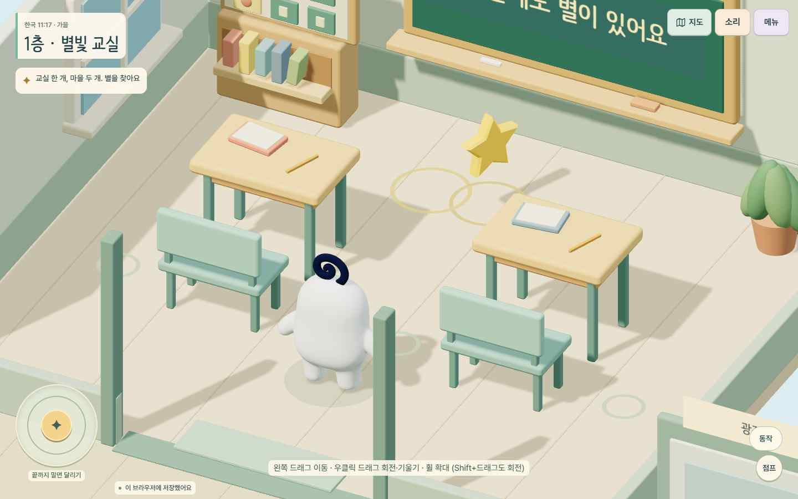
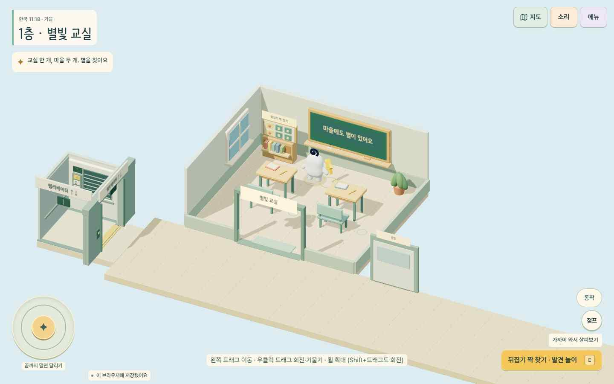
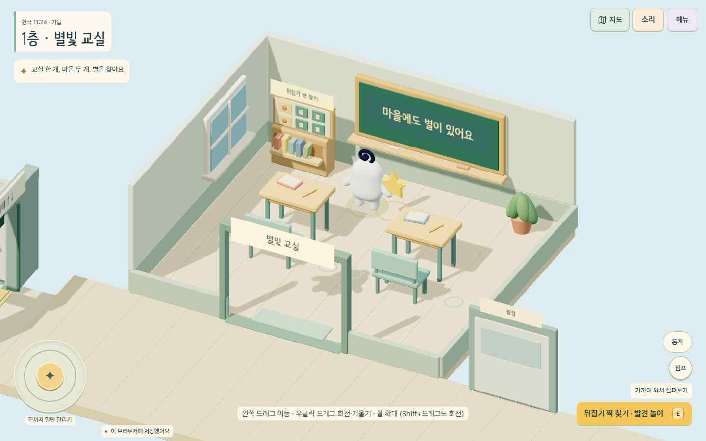
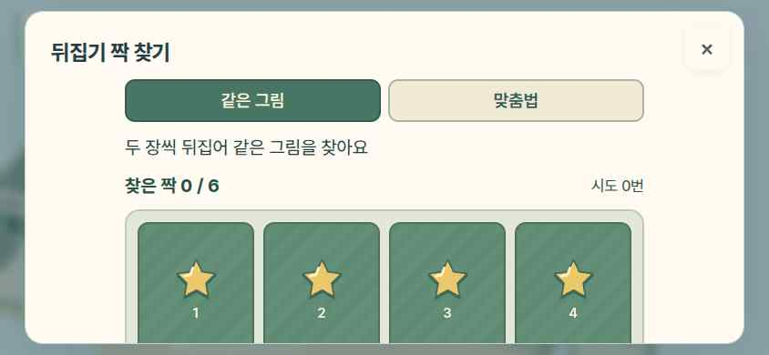
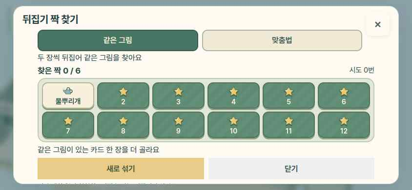
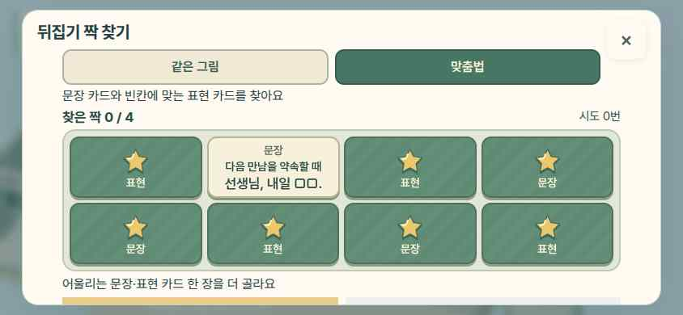

# 별빛 교실 화면 구도 · 2026-11-21

Windows Edge 1440×900에서 지도로 1층을 거쳐 별빛 교실을 열었다. 기존 진입 화면은 칠판과 방 바깥쪽을 잘랐다. 같은 장소에서 **방 맞춤**을 누르면 화면 중앙의 교실이 작아져 책상과 도름이를 다시 찾기 어려웠다. 수정 후 두 동선이 같은 구도로 연결되고 칠판·문·책상과 도름이가 함께 보인다.

| Edge 1440×900 | 진입 | 방 맞춤 | 전체 보기 | 방으로 돌아오기 |
| --- | ---: | ---: | ---: | ---: |
| 수정 전 도름이 높이 지표 | 226px | 72px | 12px | 72px |
| 수정 후 도름이 높이 지표 | 115px | 115px | 12px | 115px |
| 수정 전 교실 바닥 투영 너비 | 1789px, 양쪽 잘림 | 570px | 91px | 570px |
| 수정 후 교실 바닥 투영 너비 | 907px | 907px | 91px | 907px |

도름이 높이 지표는 게임 카메라에서 발부터 1.58m까지를 투영한 값이다. 모델 실루엣에 대한 픽셀 판정을 뜻하지 않는다. 수동 축소의 57px 투영, 전체 보기에서 되돌아오기, 짝 찾기 열고 닫기, 보건실로 지도 이동을 확인했다. 휴대폰 390×844와 태블릿 768×1024에서 각각 9장과 조작 검사를 마쳤다. 두 세로 규격의 기존 구도·확대 값은 그대로였다. 모든 기록에 페이지·HTTP 오류는 없었다.

- 수정 전과 후의 실행에는 동일한 3D 앱과 실제 지도·카메라 버튼을 사용했다. 칠판의 상호작용을 똑같이 열기 위한 근접 위치만 충돌·시야 검사를 거쳐 준비했다. 아래는 1440×900에서 저장해 직접 본 JPG다. 전체 PNG와 JSON은 실행의 Artifacts에 있다. [수정 전 3규격](https://github.com/ainssam/dorm-village/actions/runs/44854928664) · [수정 후 3규격](https://github.com/ainssam/dorm-village/actions/runs/44855498230)
- 960×520 이상에서는 넓은 화면의 모서리 조작부를 고려하고 교실 전체에 100%로 맞춘다. 화면의 직접 확대·축소와 학교 전체 보기는 그대로 조작할 수 있다. [검수 소스](https://github.com/ainssam/dorm-village/commit/7943ac01a6befea06878b99bc77dd0c0ffc4428b)

## 수정 전 · 교실 진입

## 수정 전 · 방 맞춤

## 수정 후 · 방 맞춤

## 가로로 돌린 화면의 짝 찾기

기존 844×390에서 활동 창은 366px인데 카드와 안내의 스크롤 높이는 960px이었다. 처음에는 12장 중 첫 줄 일부만 보였다. 그림 12장은 6열 2줄, 맞춤법 8장은 4열 2줄로 배치했다. 카드 높이는 각각 54px·76px이고 맞춤법의 문장·상황·표현도 카드 경계 안에 들어간다. 그림·맞춤법 카드를 실제로 뒤집고 닫기를 확인했다. 667×375에서도 모든 카드를 한 화면에서 선택할 수 있다. 설명과 새로 섞기까지는 필요할 때 아래로 스크롤할 수 있고 상단 닫기 버튼은 바로 보인다. 390×844 세로에서는 기존 화면을 열어 두 모드를 확인했다. [가로·세로 조작 실행](https://github.com/ainssam/dorm-village/actions/runs/44856076246)

가로 1024×768 태블릿에서도 교실 전체와 도름이 높이 지표 95px을 한 화면에 확인했다. 가로 844×390 휴대폰에서는 좁은 화면의 기존 구도와 손 조작을 확인했다. 모두 카메라 조절과 보건실 진입을 포함한 9장 및 조작 검증을 완료했다. [가로 카메라 실행](https://github.com/ainssam/dorm-village/actions/runs/44855754893)
