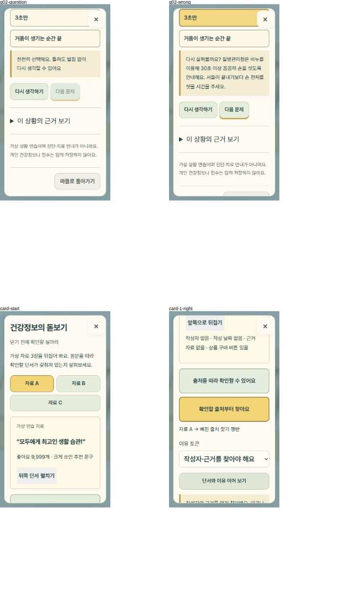
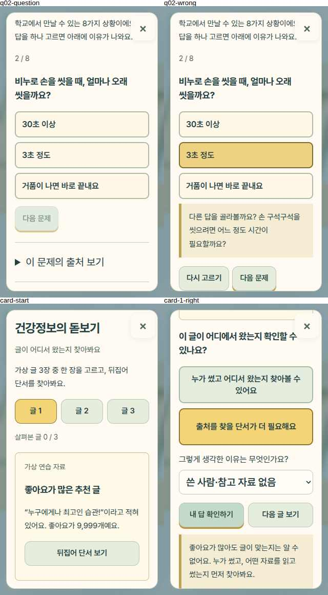

# 보건실 퀴즈와 건강정보 읽기 검수

기준 소스 `3abcca53e329f12357461bf97261906a3169d358`와 보건실 수정 소스 `5818d5747def2a842cc771911fc1efaa8cd2be30`를 각각 실행했다. 학교 보건실에서 실제 키보드와 터치로 두 활동을 열어, 문제·단서·답 선택·설명·완료 화면을 캡처했다. 보건실로 이동하는 데 앱의 방 전환을 사용했고, 앱의 충돌 및 상호작용 거리 검사에 통과한 위치에서 실제 행동 버튼을 눌렀다.

1. **생활 건강 퀴즈:** “안내판의 시간”이라는 간접 질문을 “비누로 손을 씻을 때, 얼마나 오래 씻을까요?”로 바꿨다. 오답에서 한 가지 힌트를, 정답에서 이유를 확인한다. 다음 문제를 누르면 새 질문이 보인다. 고른 답의 키보드 초점을 유지한다.
2. **건강정보의 돋보기:** 글 한 장을 고르고 뒤집은 다음 출처와 이유를 순서대로 고른다. 예전에는 쟁반이나 토큰의 역할을 해석해야 했고, 320px에서는 뒤집은 단서와 확인 결과가 아래쪽에 일부 가렸다. 처음부터 단서 버튼 전체가 보이고, 선택한 이유는 좁은 선택 상자 안에 들어가며, 확인 직후 해설로 스크롤한다.
3. **다시 보기:** 문제를 틀린 뒤 다시 고르기, 8문항 완료 및 다시 시작, 참고 자료 펼치기를 확인했다. 건강정보 세 장에서 잘못된 이유를 선택한 뒤 고쳐 완료했고, 같은 방문에서 앞서 확인한 글을 다시 열어 선택을 확인했다.

| 화면 | 수정 전 | 수정 후 |
|---|---|---|
| 초소형 휴대폰 320 × 568 | 39장. 다음 문제의 질문과 첫 카드 단서·해설이 일부 가렸다. [infirmary-before-320](https://github.com/ainssam/dorm-village/actions/runs/44855496056/artifacts/14687039037) | 39장. 8문항과 자료 3장 완료. 브라우저 오류 0. [infirmary-after-320](https://github.com/ainssam/dorm-village/actions/runs/44855994619/artifacts/14688030571) |
| PC 1440 × 900 | 39장. 선택 시 기존 버튼이 사라져 키보드 초점을 잃었다. [infirmary-before-1440](https://github.com/ainssam/dorm-village/actions/runs/44855496056/artifacts/14687821013) | 39장. 8문항과 자료 3장 완료. 브라우저 오류 0. [infirmary-after-1440](https://github.com/ainssam/dorm-village/actions/runs/44855994619/artifacts/14687956017) |

수정 전후 각 2규격 156장을 보존했다. 320px에서 2번 문항, 오답 힌트, 카드 시작, 카드 설명 네 화면을 다시 봤다. 아래 표의 사진은 각각 같은 화면 크기로 캡처했으며 썸네일 배치가 다르다. 수정판의 첫 단서 버튼 높이는 48px이고 463–511px 구간에 전부 들어온다.

| 수정 전 320px | 수정 후 320px |
|---|---|
|  |  |

Chromium의 화면 크기와 터치 설정을 사용했다. 실제 기기별 성능과 보조공학, 수업 효과는 이 검수 범위에 포함하지 않았다.
